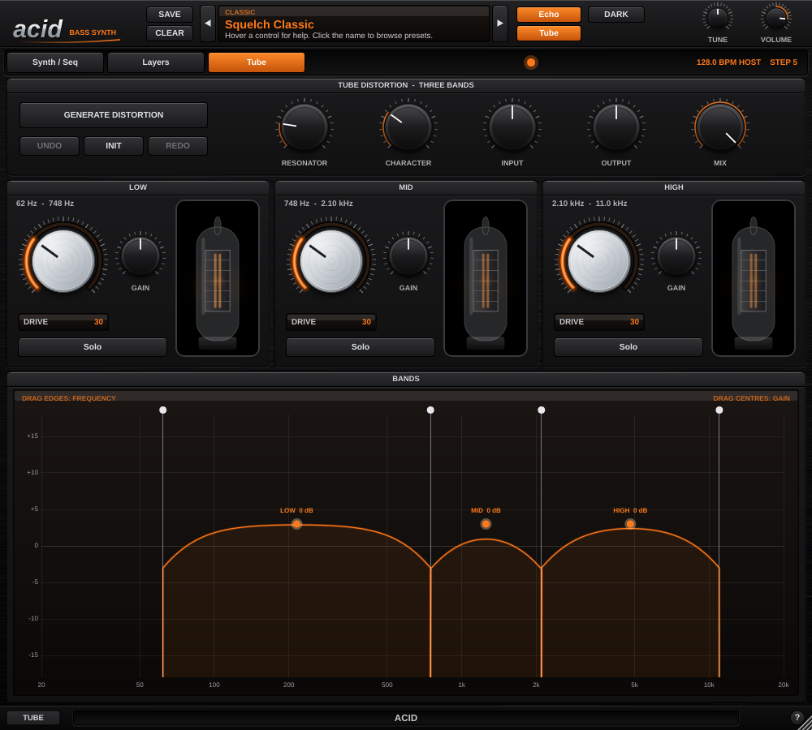

# ACID

A 303-style monophonic acid bass synthesizer: a VST3 instrument for Windows and a
VST3 / Audio Unit instrument for macOS, built with JUCE 8. It has an original, procedurally drawn GUI in the style of Virus Delay,
with no image assets.


## Download

Every push to `main` builds the plugin on GitHub Actions and publishes it to the
**`builds`** branch:

* `ACID-VST3-Windows-x64.zip` (Windows VST3)
* `ACID-macOS-Installer.pkg` (macOS VST3 + Audio Unit, universal: Apple Silicon and Intel, macOS 10.13+)

### Installing on Windows
Unzip it and copy `Acid.vst3` to `C:\Program Files\Common Files\VST3\`, then rescan
plugins in your DAW. Acid is an instrument: it plays from MIDI and from its own sequencer.

### Installing on macOS
Run `ACID-macOS-Installer.pkg`. It installs `Acid.vst3` into `/Library/Audio/Plug-Ins/VST3`
and `Acid.component` into `/Library/Audio/Plug-Ins/Components` (choose *Customize* to
install only one). Plugins put there by the installer don't carry the "downloaded from
the internet" flag, so your DAW opens them without the "Apple cannot check it for
malicious software" message.

The installer itself isn't signed with an Apple Developer ID, so macOS asks about it the
first time: right-click (or Control-click) the .pkg and choose **Open**, then **Open**
again. On macOS 15 or later, if there's no Open button, go to **System Settings >
Privacy & Security**, scroll down to the message about the installer and click
**Open Anyway**. You only need to do this once per download. Then rescan plugins in
your DAW (Logic Pro checks the Audio Unit by itself).

## Pages

### Synth
| Section | Controls |
|---|---|
| **Osc** | Wave (Saw / Square: the square is shaped from the saw, 303-style), wave display, **Retro** (slow pitch drift, per-note variation, softer top end) |
| **Filter** | **Cutoff** and **Resonance** (large), **Cutoff Low** (the floor the envelope falls back to), Drive, Bass, Treble, **Transistor** (diode ladder by default; this switches to a transistor ladder) |
| **Envelope** | Env Mod, Decay, Accent, Gate, Env Attack, Acc Decay, **Acc Sweep** (consecutive accents build the cutoff up), live ENV / ACC meter |
| **Sequencer** | Play, Seq, Key, Pattern (P01-P16), Length (1-64), Swing, Slide time, Transpose, Rate (1/8, 1/16, 1/16T, 1/32), Direction (Forward / Reverse / Ping-Pong / Random), step pages, Follow |
| **Tools** | Random (everything / notes / accents / slides / octaves, with root and scale), Mutate, Clear, rotate left / right, Copy / Paste, Undo / Redo, MIDI (drag the button into your DAW for a MIDI clip, export / import .mid, MIDI out on/off) |
| **Grid** | One-octave piano roll with slide lines and octave markers, plus rows for Up, Down, Accent, Slide, Ratchet (1-4 hits) and Gate (Note / Rest / Tie). Click or drag to edit, right-click a note for a rest, click a step number to set the length. |

### Layers


Osc B (level, tune, detune) · Unison (1-8 voices, spread, free / reset phase) ·
Amp envelope (attack, decay or hold, release) · **Echo** (sync, time, mix, feedback,
low cut and high cut inside the loop, ping-pong width) · **2 LFOs** (rate free or
synced, depth +-, phase, 7 shapes, sync, mirror, retrigger Free / Note / Bar,
destination Cutoff / Pitch / Wave / Reso / Volume).

### Tube


Three-band tube distortion: Linkwitz-Riley crossovers, with clean signal below the low
edge and above the high edge. Each band has a 4x oversampled tube with Drive, Gain and
Solo, and a tube that glows with the band's level. Global Resonator, Character, Input,
Output and Mix. **Generate Distortion** randomises the settings, with Undo / Init / Redo.
In the band graph, drag the edges for the frequencies and the centres for the gains.

### Header
Save, Clear (sound back to default), the preset display (‹ ›, click it to browse the
20 factory presets and your user presets), Echo / Tube on-off, Dark / Light theme,
Tune and Volume. Hover over any control to see its value and a short explanation in
the display.

**Knobs** move in whole steps of 1. Drag, or use the mouse wheel (one notch = one
step). Double-click resets to the default. The window resizes from 60 % to 200 % by
dragging the bottom-right corner, and remembers its size.

## Sequencer behaviour
* Steps lock to the host's song position, sample-accurately. With the host stopped,
  **Play** runs the pattern on its own clock.
* **Slide** on a step holds the gate into the next step, which glides there (no
  envelope retrigger). **Tie** extends the previous note. **Rest** plays nothing.
* **Accent** applies at note-on, also to slid notes. **Ratchet** splits a step into
  2-4 hits.
* **Key** mode: a held MIDI key transposes the pattern (relative to C) and gates it.
* With **Seq** off, or while the pattern is stopped, MIDI plays the synth directly.
  Overlapping notes slide and velocity >= 100 is an accent.

## Building

**Windows**: Windows 10/11, Visual Studio 2022 (Desktop C++), CMake 3.22+ and Git.
CMake downloads JUCE 8.0.4 and Catch2.

```bat
cmake -B build -A x64
cmake --build build --config Release --target Acid_VST3
```

The plugin ends up in `build\Acid_artefacts\Release\VST3\Acid.vst3`. Add
`-DACID_COPY_AFTER_BUILD=ON` to install it into the VST3 folder automatically.

**macOS**: Xcode and CMake 3.22+. This builds a universal VST3 + AU and the installer:

```bash
cmake -B build -G Xcode -DCMAKE_OSX_ARCHITECTURES="arm64;x86_64"
cmake --build build --config Release --target Acid_VST3 Acid_AU
packaging/macos/build_installer.sh build/Acid_artefacts/Release 0.1.0 out
```

Unit tests (DSP and sequencer, plain C++):

```bat
cmake --build build --config Release --target AcidTests
build\Release\AcidTests.exe
```

Options: `-DACID_PLUGIN_NAME="NewName"` renames the plugin,
`-DACID_BUILD_STANDALONE=ON` adds a standalone app, `-DJUCE_DIR=path` uses a local
JUCE checkout, and `-DACID_BUILD_TOOLS=ON` builds `RenderCheck` (an offline render and
screenshot tool).

## Project layout
```
src/dsp/      oscillator, ladder filter, envelopes + accent circuit, voice, LFO,
              tone stack, crossover, multiband tube, echo (plain C++, unit-tested)
src/seq/      step / pattern model, sequencer engine, random / mutate / rotate,
              undo, MIDI export / import
src/presets/  preset manager (JSON user presets) and the factory presets
src/ui/       look-and-feel, knob, widgets, step grid, band graph, tube view, pages
tests/        Catch2 tests (filter stability, accent sweep, slide timing,
              sequencer rules, crossover flat sum, oversampling latency ...)
```

See [DECISIONS.md](DECISIONS.md) for the design choices.
