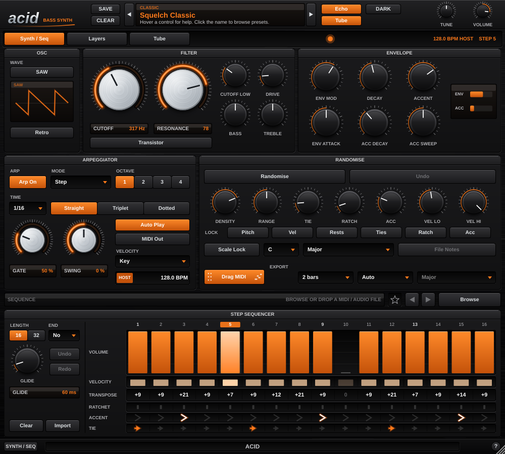
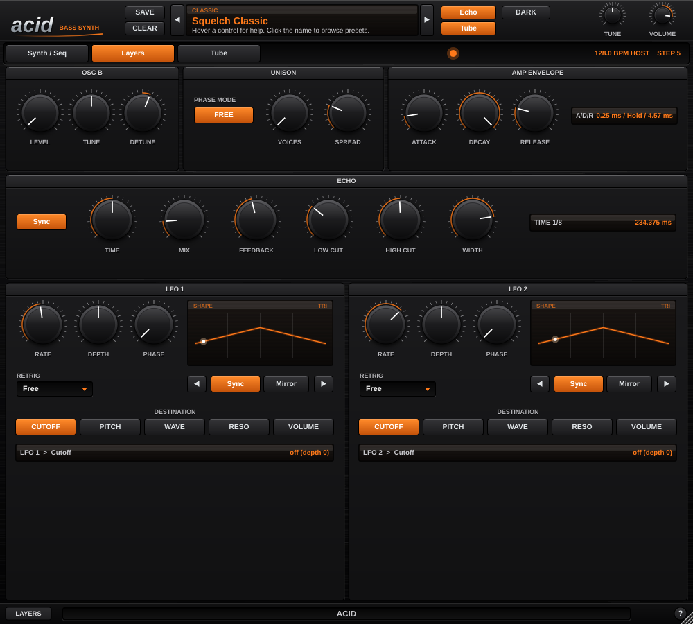

# ACID

A 303-style monophonic acid bass synthesizer: a VST3 instrument for Windows and a
VST3 / Audio Unit instrument for macOS, built with JUCE 8. It has an original, procedurally drawn GUI in the style of Virus Delay,
with no image assets.



## Download

Every push to `main` builds the plugin on GitHub Actions and publishes it to the
**`builds`** branch:

* `ACID-VST3-Windows-x64.zip` (Windows VST3)
* `ACID-macOS-Installer.pkg` (macOS VST3 + Audio Unit, universal: Apple Silicon and Intel, macOS 10.13+)

### Installing on Windows
Unzip it and copy `Acid.vst3` to `C:\Program Files\Common Files\VST3\`, then rescan
plugins in your DAW. Acid is an instrument: it plays from MIDI and from its own sequencer.

### Installing on macOS
Run `ACID-macOS-Installer.pkg`. It installs `Acid.vst3` into `/Library/Audio/Plug-Ins/VST3`
and `Acid.component` into `/Library/Audio/Plug-Ins/Components` (choose *Customize* to
install only one). Plugins put there by the installer don't carry the "downloaded from
the internet" flag, so your DAW opens them without the "Apple cannot check it for
malicious software" message.

The installer itself isn't signed with an Apple Developer ID, so macOS asks about it the
first time: right-click (or Control-click) the .pkg and choose **Open**, then **Open**
again. On macOS 15 or later, if there's no Open button, go to **System Settings >
Privacy & Security**, scroll down to the message about the installer and click
**Open Anyway**. You only need to do this once per download. Then rescan plugins in
your DAW (Logic Pro checks the Audio Unit by itself).

## Pages

### Synth / Seq
The synth and its sequencer share one page. The sequencer is the **ArpSampler** arpeggiator and
step sequencer. Acid's **Glide** stays: it's in the Step Sequencer panel.

| Section | Controls |
|---|---|
| **Osc** | Wave (Saw / Square, the square shaped from the saw 303-style), wave display, **Retro** (slow pitch drift, per-note variation, softer top end) |
| **Filter** | **Cutoff** and **Resonance** (large), **Cutoff Low** (the floor the envelope falls back to), Drive, Bass, Treble, **Transistor** (diode ladder by default, or a transistor ladder) |
| **Envelope** | Env Mod, Decay, Accent, Env Attack, Acc Decay, **Acc Sweep** (consecutive accents build the cutoff up), live ENV / ACC meter |
| **Arpeggiator** | Arp On, Mode (Up, Down, Up/Down, Up/Down2, Down/Up, Down/Up2, Random, Ordered, **Step**, Chord), Octave 1-4, Time (1/2-1/32, Straight / Triplet / Dotted), Gate 1-200 %, Swing -100 to +100 %, Velocity mode (Key, Hold, Step, Step+Key, Step+Hold), **Auto Play**, **MIDI Out**, Tempo (host, or the internal BPM) |
| **Randomise** | Randomise / Undo, Density, Range, Tie, Ratch, Acc, Vel Lo, Vel Hi, Lock Pitch / Vel / Rests / Ties / Ratch / Acc, **Scale Lock** with Key and 16 scales, **File Notes**, **Drag MIDI** with length (1-8 bars), root and chord |
| **Sequence** strip | The MIDI or audio file the steps came from, favourite star, previous / next file, **Browse** (the Sequence Browser: folders, favourites, tags and search; each file you pick loads into the steps in your Key / Scale) |
| **Step Sequencer** | Length 16 / 32, End, **Glide**, Undo / Redo, Clear, Import (a MIDI file, or the notes of an audio file; or drop a file on the grid). Lanes: **Volume** (bottom = rest), **Velocity**, **Transpose**, **Ratchet** (1-4 hits), **Accent**, **Tie** |

### Layers


Osc B (level, tune, detune) · Unison (1-8 voices, spread, free / reset phase) ·
Amp envelope (attack, decay or hold, release) · **Echo** (sync, time, mix, feedback,
low cut and high cut inside the loop, ping-pong width) · **2 LFOs** (rate free or
synced, depth +-, phase, 7 shapes, sync, mirror, retrigger Free / Note / Bar,
destination Cutoff / Pitch / Wave / Reso / Volume).

### Tube


Three-band tube distortion: Linkwitz-Riley crossovers, with clean signal below the low
edge and above the high edge. Each band has a 4x oversampled tube with Drive, Gain and
Solo, and a tube that glows with the band's level. Global Resonator, Character, Input,
Output and Mix. **Generate Distortion** randomises the settings, with Undo / Init / Redo.
In the band graph, drag the edges for the frequencies and the centres for the gains.

### Header
Save, Clear (sound back to default, the pattern stays), the preset display (‹ ›, click it
to browse the 20 factory presets and your user presets), Echo / Tube on-off, Dark / Light
theme, Tune and Volume. Hover over any control to see its value and a short explanation in
the display.

**Knobs** move in whole steps of 1. Drag, or use the mouse wheel (one notch = one
step). Double-click resets to the default. The window (1000 x 900 at 100 %) resizes from
60 % to 200 % by dragging the bottom-right corner, and remembers its size.

## How the sequencer plays Acid
* It works as in ArpSampler: steps lock to the host's bars; with the host stopped, the
  clock starts at the first key you press. **Step** mode (the default) plays the step
  sequence from the key you hold. **Auto Play** (on by default) plays it whenever the host
  plays, from the Key's root in the bass octave (C1 for C, A1 for A); a key you play takes
  over while you hold it.
* Acid is monophonic: each new step retriggers the voice, and the newest note wins (in
  Chord mode, the top note).
* **Tie** holds the step into the next one without retriggering. A tie to a new pitch
  **glides** there over the **Glide** time, which is the 303 slide.
* **Accent** plays at full velocity and fires Acid's accent: louder, with the filter kick
  and the **Acc Sweep** build-up.
* Loudness is the note's velocity (from the Velocity mode) times the step's **Volume**.
  **Volume 0** is a rest.
* **MIDI Out** sends the notes (the Velocity lane as velocity, the Volume lane as CC11) to
  drive another instrument. **Drag MIDI** renders the same notes into a clip.
* With **Arp On** off, MIDI plays the synth directly. Last-note priority; overlapping notes
  slide; velocity 100 or more is an accent.
* ArpSampler's **Reverse** lane is left out: a synth oscillator has no sample to play
  backwards.

## Building

**Windows**: Windows 10/11, Visual Studio 2022 (Desktop C++), CMake 3.22+ and Git.
CMake downloads JUCE 8.0.4 and Catch2.

```bat
cmake -B build -A x64
cmake --build build --config Release --target Acid_VST3
```

The plugin ends up in `build\Acid_artefacts\Release\VST3\Acid.vst3`. Add
`-DACID_COPY_AFTER_BUILD=ON` to install it into the VST3 folder automatically.

**macOS**: Xcode and CMake 3.22+. This builds a universal VST3 + AU and the installer:

```bash
cmake -B build -G Xcode -DCMAKE_OSX_ARCHITECTURES="arm64;x86_64"
cmake --build build --config Release --target Acid_VST3 Acid_AU
packaging/macos/build_installer.sh build/Acid_artefacts/Release 0.1.0 out
```

Unit tests (DSP and sequencer, plain C++):

```bat
cmake --build build --config Release --target AcidTests
build\Release\AcidTests.exe
```

Options: `-DACID_PLUGIN_NAME="NewName"` renames the plugin,
`-DACID_BUILD_STANDALONE=ON` adds a standalone app, `-DJUCE_DIR=path` uses a local
JUCE checkout, and `-DACID_BUILD_TOOLS=ON` builds `RenderCheck` (an offline render and
screenshot tool).

## Project layout
```
src/dsp/      oscillator, ladder filter, envelopes + accent circuit, voice, LFO,
              tone stack, crossover, multiband tube, echo (plain C++, unit-tested)
src/arp/      the ArpSampler sequencer: arp engine, pattern model, scales, randomiser,
              MIDI writer, import (MIDI / audio), export (Drag MIDI), sequence library
src/presets/  preset manager (JSON user presets) and the factory presets
src/ui/       look-and-feel, knob, widgets, step grid, band graph, tube view, pages
tests/        Catch2 tests: DSP (filter stability, accent sweep, slide timing, crossover
              flat sum, oversampling latency ...) and the sequencer (step timing, ties,
              rests, accents, ratchets, preset conversion, import, export, randomise)
```

See [DECISIONS.md](DECISIONS.md) for the design choices.
